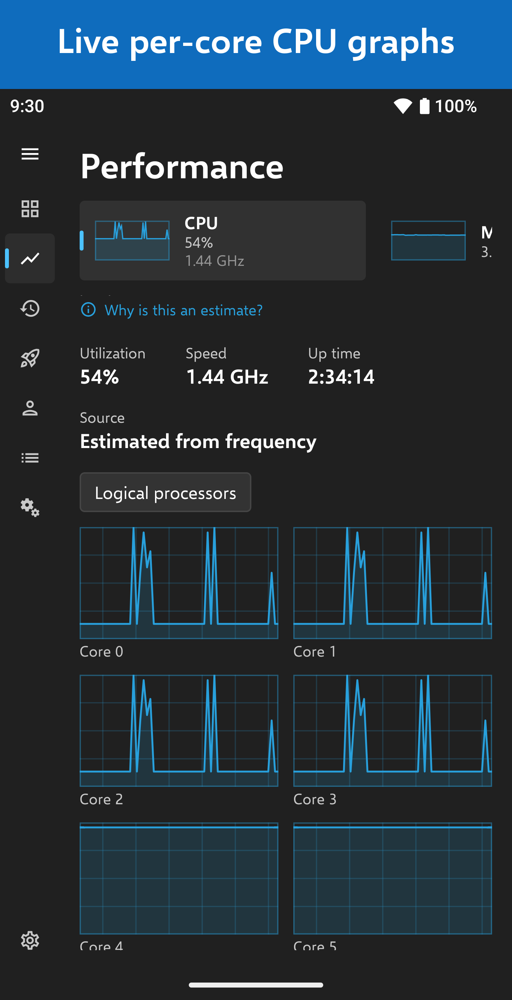
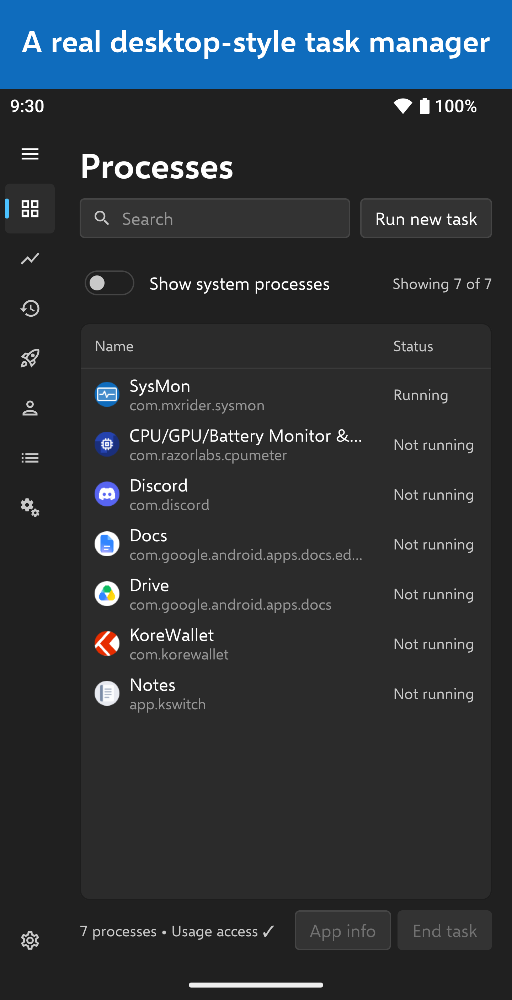
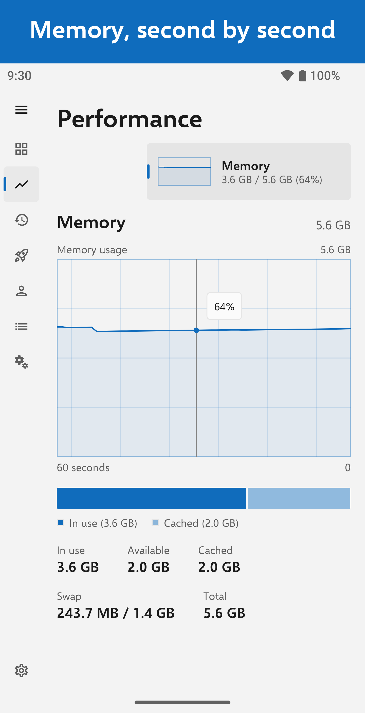
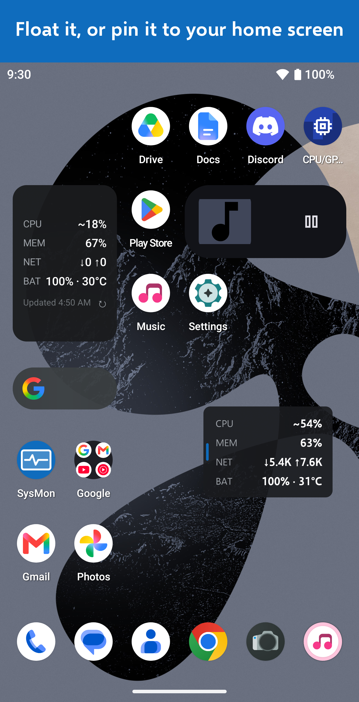

# SysMon — Task Manager for Android

A desktop-style task manager and system monitor for Android, inspired by the Windows 11 Task Manager. Native Kotlin + Jetpack Compose, styled after the Fluent design language (Mica-style surfaces, Selawik typeface, accent-tinted live charts).

**Private by design: the app requests no `INTERNET` permission.** Nothing ever leaves the device, and you can verify that yourself by inspecting the APK's permission list. No ads, no analytics, no trackers.

<p>
  
  
  
  
</p>

## Download

Signed APKs are attached to each [GitHub release](../../releases). Requires Android 8.0 (API 26) or newer.

## Editions

One codebase, two editions. The main app is **free and complete** (`com.mxrider.sysmon`, Gradle flavor `free`). **SysMon Supporter** (`com.mxrider.sysmon.supporter`, flavor `supporter`) is a feature-identical paid edition on Google Play for people who want to fund development; with no `INTERNET` permission there is no other way to accept donations. The only differences are the launcher label, an About-card edition line and the package name, so both can be installed side by side.

## Screens

| Task Manager tab | SysMon screen | Data source |
|---|---|---|
| Processes | Recently active apps, screen time, network and storage per app, End task | `UsageStatsManager`, `NetworkStatsManager`, `StorageStatsManager` |
| Performance | Live 60-second charts: CPU (incl. per-core small multiples), Memory (+ composition bar), Network (receive/send), Storage, Battery (power draw in watts + temperature, with a fuel-gauge capacity estimate), Thermal (OS throttling status + per-sensor temperatures where the device permits them), GPU (identity always; total load only where the vendor's counter is readable, which is a minority of devices) | `/proc`, `/sys` cpufreq, `/sys/class/thermal`, `/sys/class/kgsl`, `ActivityManager`, `TrafficStats`, `BatteryManager`, `PowerManager`, `StorageManager`, EGL |
| *(no counterpart)* | Timeline: the performance log charted over 1 h / 6 h / 24 h / 7 d / everything (CPU, memory, battery level, power draw, temperature, network) with screen-on shading and crosshair scrubbing. Recording gaps stay gaps; nothing is interpolated | the app's own CSV performance log (Settings → Performance logging) |
| App history | Screen time / launches / Wi-Fi and mobile data per app over Today / 7 / 30 days | `UsageStatsManager`, `NetworkStatsManager` |
| Startup apps | Apps registered for boot (`BOOT_COMPLETED` receivers) with an impact heuristic | `PackageManager` |
| Users | Device users and work profiles (Android exposes limited info) | `UserManager` |
| Details | Full installed-app inventory: versions, SDKs, sizes, installer, dates | `PackageManager` |
| Services | Declared services of installed apps, exported/enabled/FGS types | `PackageManager` |
| Settings | Theme, accent, update speed (High/Normal/Low/Paused), start page, readout notifications, floating monitor, performance logging | DataStore |

Also included: optional status-bar readout notifications (CPU, memory, network, battery), a draggable floating mini-monitor, and a home-screen widget.

### Honest platform limits (surfaced in-app, never faked)

- Per-process CPU/RAM of *other* apps is not available to third-party apps on modern Android. CPU utilization is measured from `/proc/stat` where readable, otherwise estimated from per-core frequency scaling and labeled as such (estimates are marked with `~`).
- The optional readout notifications (foreground service, off by default) show the same figures under the same rules, and sampling pauses while the screen is off.
- The home-screen widget uses Jetpack Glance, which transitively adds `WAKE_LOCK` and `RECEIVE_BOOT_COMPLETED` to the merged manifest (Glance composes widgets inside WorkManager). SysMon declares neither and registers no boot receiver of its own. AndroidX core also adds `<package>.DYNAMIC_RECEIVER_NOT_EXPORTED_PERMISSION`, a signature-level permission that keeps SysMon's internal receivers private to SysMon.
- The widget samples at refresh time (tap ↻, or the platform's 30-minute cycle) and stamps every card with "Updated HH:mm" instead of passing a stale number off as live.
- The floating mini-monitor needs "Display over other apps". Android hides *all* third-party overlays while security-sensitive screens are in front (for example the Settings app), so the card disappears there and comes back on its own. If the special access is revoked, the toggle turns itself off.
- "End task" uses `killBackgroundProcesses` (a no-op for other apps since API 34) and always offers the App info deep link, where the user can Force stop.
- Live service state is not exposed; the Services screen shows declared services.

## Building

Requirements: JDK 17 or newer and the Android SDK with platform 36. Point Gradle at the SDK with `ANDROID_HOME` or a `local.properties` file containing `sdk.dir=/path/to/Android/Sdk` (Android Studio creates it for you).

```bash
./gradlew assembleFreeDebug        # debug APK: app/build/outputs/apk/free/debug/
./gradlew assembleFreeRelease      # signed release APK (needs signing, see below)
./gradlew bundleFreeRelease        # signed release AAB for Google Play
```

Replace `Free` with `Supporter` for the Supporter edition. Debug builds install alongside a release build (`.debug` package suffix).

`gradle.properties` is tuned for a machine with 4 GB of RAM (a single worker, in-process Kotlin compilation). On a bigger machine you can raise `org.gradle.jvmargs` and `org.gradle.workers.max` in `~/.gradle/gradle.properties`, which takes precedence.

### Release signing

Release builds are signed with credentials that never enter the repository. Either create `keystore.properties` in the repository root (it is git-ignored):

```properties
storeFile=/absolute/path/to/upload-keystore.jks
storePassword=...
keyAlias=...
keyPassword=...
```

or set the environment variables `SYSMON_KEYSTORE_FILE`, `SYSMON_KEYSTORE_PASSWORD`, `SYSMON_KEY_ALIAS` and `SYSMON_KEY_PASSWORD`. Without them, packaging a release fails with a clear error instead of producing an unsigned file by surprise; pass `-Psysmon.allowUnsignedRelease=true` if you really want an unsigned build (for example to sign it yourself afterwards).

## Translations

The UI is localized in English, German, French, Spanish, Brazilian Portuguese, Italian, Polish, Japanese and Korean, and the Android 13+ per-app language picker is wired up via `localeConfig`. Each locale has one consolidated file at `app/src/main/res/values-<locale>/strings.xml`. After changing any string, run:

```bash
python3 tools/check_translations.py
```

It checks that every locale covers every base string, that format placeholders survive translation, and that plurals are complete. Corrections from native speakers are very welcome.

## Architecture

Single `:app` module, no DI framework, a small manual service locator (`Graph` in `SysMonApp.kt`).

```
core/           data models, monitor/repository interfaces, ChartHistory, Ticker, Format
data/system/    CPU, memory, network, battery, storage, thermal and GPU collectors
data/apps/      PackageManager / UsageStats / NetworkStats repositories, task killer
data/logging/   CSV performance-log writer and reader
service/        readout notifications, floating monitor and performance logging (one foreground service)
settings/       DataStore-backed SettingsStore
ui/theme/       Fluent tokens (colors, Selawik typography, metrics)
ui/components/  NavRail, DataTable, Fluent controls, charts
ui/screens/     one package per screen + its ViewModel
ui/widget/      the Glance home-screen widget
```

## Privacy

See the [privacy policy](store/PRIVACY_POLICY.md). In short: SysMon collects nothing, transmits nothing and shares nothing.

## Licensing notes

- Selawik font © Microsoft, SIL Open Font License 1.1 (`SELAWIK_LICENSE.txt`). Attribution is shown in Settings → About.
- The app is *Fluent-inspired* but uses no Microsoft trademarks or icons, and not the "Windows" name, anywhere in the product, listing or marketing. SysMon is an independent app and is not affiliated with Microsoft.
